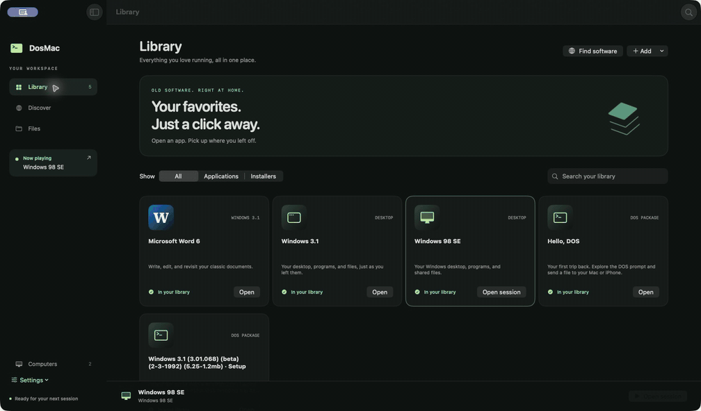
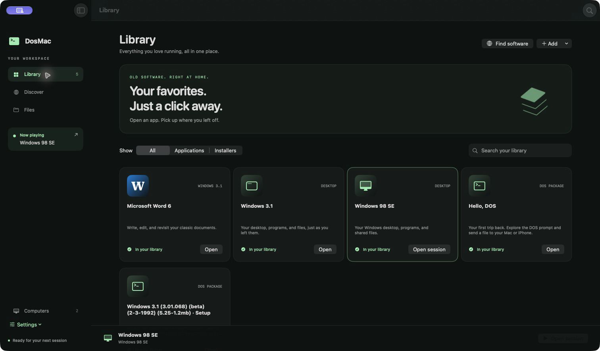
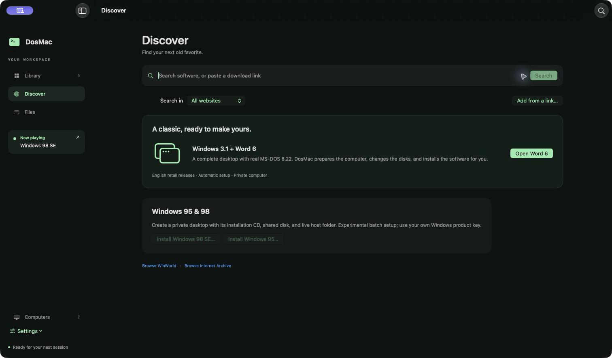
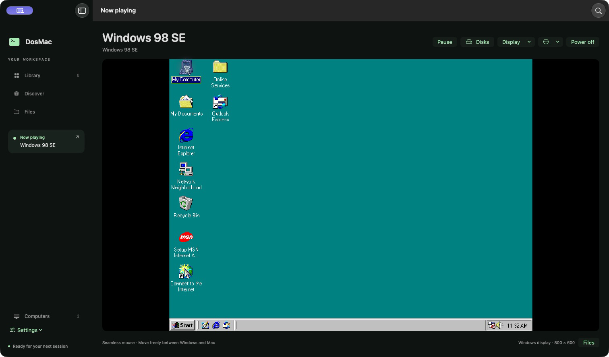

<div align="center">

# DosMac

**Old software. Right at home.**

A native Mac workspace for DOS, Windows 3.1, and Windows 9x.
Real emulated PCs, an app-first library, and files shared with your Mac.

[](LICENSE)


[Get started](#get-started) · [Compatibility](#compatibility) · [Build](#build-from-source) · [Documentation](#documentation)



</div>

## A home for your old favorites

Open Word from your Library, return to an entire Windows desktop, or find another classic in Discover. DosMac manages the computer, installation media, and emulator behind that workflow.

- **Your apps come first.** A searchable Library holds Windows desktops, installed applications, custom guest shortcuts, and imported `.dosmac` packages. Navigation keeps the running session alive.
- **Complete PCs.** The QEMU backend emulates x86 instructions and PC hardware, with BIOS boot, private QCOW2 hard disks, floppy drives, and IDE CD-ROM. DOS is installed inside the computer; it is not an API translation layer.
- **Guided installation.** The reference MS-DOS 6.22 → Windows 3.1 → Word 6 recipe prepares a fresh computer and changes installation disks automatically. Windows 95/98 recipes prepare a computer and CD, with experimental batch Setup and pauses for keys, licenses, or unfamiliar dialogs.
- **Find software in the app.** Discover searches WinWorld and Internet Archive and accepts direct HTTPS download links. Local disk images and ISO files can also be imported.
- **Files within reach.** Use a shared FAT16 disk while the computer is stopped, or a live Windows network folder while it runs. Exchange floppies support older workflows.
- **Windows feels closer.** Guest Tools enables a seamless mouse and Windows resolution controls, including automatic fitting to the app window. Installation makes a recovery copy first.

**This is a developer preview.** Mac execution works today. The iPhone UI builds, but an on-device emulation runtime is still planned. Commercial operating systems, application media, and product keys are not included.

## Screenshots

### Your Library



### Discover software



### A complete Windows desktop



The screenshots show a local development build and separately installed guest software. The GIF is an animated tour of these real captured screens.

## Get started

There is no packaged, notarized public release yet. [Build the Mac app](#build-from-source) to try the preview.

1. Open **Discover** and choose a reference installation, or open **Computers** to create a PC and import your own media.
2. Follow the installation helper. Enter your own Windows product key and accept applicable licenses locally when requested. Unknown screens pause for your input.
3. Open the installed desktop or application from **Library**. Add shortcuts for other programs already installed inside that computer.
4. Use **Now playing → Disks** whenever an installer needs another floppy or a CD. The current disk and media order remain visible.

For the smallest first run, install **Hello, DOS**. This original redistributable demo uses the classic package backend and writes a text file to the shared Exchange folder.

### Files between Mac and guest

| Method | When to use it | How it works |
| --- | --- | --- |
| Shared disk | DOS and older Windows; bulk transfer between sessions | A 64 MiB FAT16 disk, mounted in Finder only while the PC is stopped. DosMac unmounts it before guest startup. |
| Live folder | Windows 9x; files needed while the PC runs | The managed network share `\\DOSHOST\DOSMAC`, mapped to **H:** by the Windows recipe. |
| Exchange floppy | Older installers and document export | Import or export files through a managed floppy image. |

Open **Files** to reach the appropriate location. Put only files intended for the guest in a shared location. The live folder uses a private legacy SMB service and requires the guest's network configuration; it does not use macOS File Sharing.

### Mouse, keyboard, and display

For an English Windows 98 computer, shut down Windows, then choose **Computers → Settings → Install Guest Tools**. With live sharing enabled and mapped to H:, the same action installs the display agent.

- **Seamless mouse:** move freely between Windows and Mac. Without Guest Tools, click the guest display to capture input; **Control + Option** releases it.
- **Display:** choose a reported Windows resolution or **Fit Windows to window**. This changes the guest's actual framebuffer. Fitting is saved per computer.
- **Guest shortcuts:** **More** sends Windows + R, Ctrl + Esc, Ctrl + Alt + Del, Alt + F4, Enter, or Escape. **Type text in guest** types paths or text using the guest's US keyboard layout.
- **Navigation:** **⌘F** focuses search; **⌘1–⌘4** open Library, Discover, Files, and Computers.

The older DOSBox-X package backend uses its own window and capture shortcuts; see [classic mouse input](docs/mouse-input.md) and [disk controls](docs/disk-controls.md).

## Compatibility

| Guest / workflow | Current state |
| --- | --- |
| MS-DOS 6.22 | Reference installation on an empty HDD and subsequent HDD boot verified. |
| Windows 3.1 + Word 6 | Full reference stack verified, including actual Word startup, document save, and export to Mac. |
| Windows 98 SE | Desktop, cold boot, shared files in both directions, and Guest Tools verified. |
| Windows 95 | Installation recipe and CD handling implemented; full desktop and Guest Tools acceptance pending. |
| Other DOS releases / PC DOS | Importable boot and installation media; each release still needs compatibility testing. |
| iPhone | Library, discovery, import/export, and simulator build available; guest execution not implemented. |

Windows 98's installed Cirrus driver currently offers **640×480, 800×600, 1024×768, and 1280×1024**. Arbitrary widescreen modes, a clipboard bridge, and a richer guest-control service remain planned.

“One click” refers to the supported installation recipes. Other releases can require manual Setup interaction. Preparing a floppy set is shown as **Setup ready**, not as an installed application. Catalog availability can change or return access/rate-limit errors; another source can still return results. Password-protected archives and catalog CD downloads are currently unsupported; import a local ISO instead.

## Build from source

### Mac app with its engine included

Requires macOS 14+, Xcode 16+ with Swift 6, Homebrew, and Python 3.12+. Run the commands from a checkout of this repository:

```sh
git clone https://github.com/asaptf/DosMac.git
cd DosMac

brew install xcodegen qemu samba python i686-elf-gcc i686-elf-binutils

# Build pinned Windows 9x compatibility firmware.
python3 scripts/build-win9x-bios.py

# Generate and build the native app.
xcodegen generate
xcodebuild -project DosMac.xcodeproj -scheme DosMac-macOS \
  -configuration Debug -destination 'platform=macOS' \
  -derivedDataPath build/macOS CODE_SIGNING_ALLOWED=NO build

# Copy QEMU, Samba, firmware, and runtime libraries into the app, then sign locally.
python3 scripts/bundle-qemu.py \
  --app build/macOS/Build/Products/Debug/DosMac.app

open build/macOS/Build/Products/Debug/DosMac.app
```

The resulting local app carries its engine; users of that bundle do not need a separate QEMU or DOSBox-X installation. Bundling is a development workflow, not a notarized release pipeline. Binary distribution needs the applicable third-party notices and corresponding source described in [third-party notices](THIRD_PARTY_NOTICES.md).

For faster source iteration, use a developer-installed QEMU (9.2 or newer) and point Windows 9x at the compatibility firmware built above:

```sh
DOSMAC_WIN9X_BIOS="$PWD/build/firmware/bios-win9x.bin" swift run DosMac
```

An explicit engine can be selected with `DOSMAC_QEMU_PATH=/absolute/path/to/qemu-system-i386`. See [machine architecture](docs/machine-architecture.md) for runtime configuration.

The display agent is already embedded. To rebuild it after changing its source, see [GuestTools/Agent](GuestTools/Agent/README.md).

A separate sandboxed `DosMac-AppStore` preparation target is in progress; its initial test package requires Apple Silicon and macOS 27 because of the bundled native dependencies. It imports local media and includes an original PC diagnostic; it does not expose the developer archive catalogs or native engine downloads. It is **not submission-ready**. See [App Store preparation and remaining gates](docs/app-store-readiness.md).

### iPhone UI preview

```sh
xcodegen generate
xcodebuild -project DosMac.xcodeproj -scheme DosMac-iOS \
  -configuration Debug -destination 'generic/platform=iOS Simulator' \
  -derivedDataPath build/iOS CODE_SIGNING_ALLOWED=NO build
```

Open the project in Xcode to choose a simulator or configure signing for a device. This builds the UI preview; it does not add an iPhone emulator runtime.

### Classic imported packages

Existing `.dosmac` packages retain the DOSBox-X compatibility backend. On first launch, DosMac downloads the official pinned engine release, verifies its checksum, and caches it privately for offline reuse. No manual DOSBox-X setup is required. A custom developer engine can be selected with `DOSMAC_ENGINE_PATH`.

See [package format](docs/packages.md), [engine delivery](docs/engine-delivery.md), and [startup modes](docs/startup.md) for this separate path.

## Development and verification

```sh
# Unit and original-fixture tests; no commercial media downloads.
swift test

# Boot a real QEMU instance using original test boot code.
DOSMAC_TEST_QEMU=1 swift test

# Exercise actual FAT16 mounting and private SMB transfer.
DOSMAC_TEST_STORAGE=1 DOSMAC_TEST_SAMBA=1 swift test --filter SharedStorageTests
```

Guest Tools acceptance also runs on a disposable copy of a locally supplied, already licensed Windows 98 disk. It verifies installation, a real mode switch, a mouse click, automatic fitting, normal shutdown, and agent startup after a cold boot. The configuration and other opt-in OS/application tests are documented in [Guest Tools](docs/guest-tools.md) and [machine architecture](docs/machine-architecture.md). Commercial media and credentials are never committed as fixtures.

Contributions are welcome. Include reproduction steps for guest issues, the guest release and engine version, and checks appropriate to the change. Keep keys, guest disks, and personal shared files out of issues and pull requests.

## Documentation

| Topic | Guide |
| --- | --- |
| Library, discovery, and navigation | [Workspace](docs/workspace.md) |
| PC lifecycle, QMP/RFB, and tests | [Machine architecture](docs/machine-architecture.md) |
| Shared disk, networking, and Windows 9x | [Host sharing and Windows 9x](docs/host-sharing-and-windows9x.md) |
| Seamless mouse and display agent | [Guest Tools](docs/guest-tools.md) |
| Catalogs and direct downloads | [Software sources](docs/software-sources.md) |
| Planned work | [Roadmap](docs/roadmap.md) |

## Data and trust

On Mac, application data lives under `~/Library/Application Support/DosMac`. Managed computers have private disks and settings; imported packages have their own C: directories and use the shared Exchange folder. Back up the relevant computer before making guest changes you may want to undo.

QEMU and the classic emulator run with the user's permissions. Private disks and package validation are not a security sandbox: run trusted guest software. The preview has no telemetry. No commercial OS, application media, or product key ships with DosMac; use media you are entitled to use.

## License

DosMac's original project code is licensed under [Apache License 2.0](LICENSE). See [NOTICE](NOTICE) for attribution.

Separately licensed components keep their own terms: QEMouse is GPL-2.0, the standalone display agent retains its MIT license, and QEMU, SeaBIOS, Samba, DOSBox-X, and Swift dependencies retain their upstream licenses. Apache-2.0 does not replace those licenses or grant rights to guest software shown in screenshots. See [third-party notices](THIRD_PARTY_NOTICES.md).
